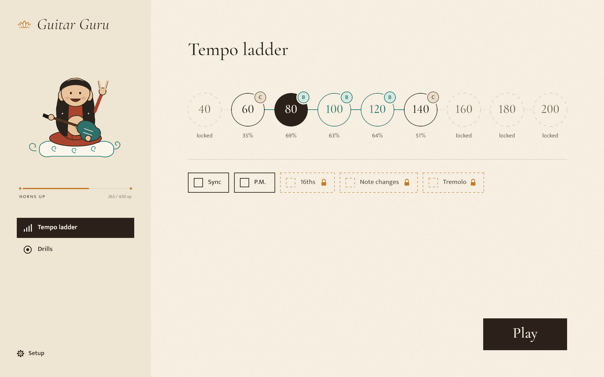
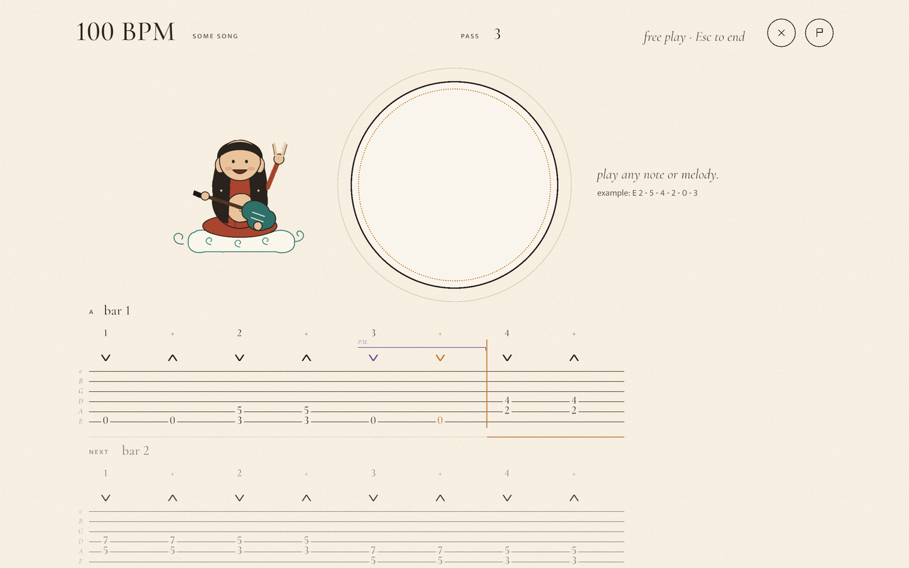

# Guitar Guru





Rhythm guitar practice for an electric guitar plugged into the computer. You play
along to a click; afterwards the app scores your timing and the evenness of your
strokes, and lets you listen back to the weakest passages.

- **Tempo ladder:** generated runs from 40 to 200 BPM, with options (syncopation, palm
  mutes, 16ths, note changes, tremolo) unlocked as you pass runs.
- **Drills:** a single pattern on repeat.
- **Practice packs:** song lists with unlock requirements and optional riffs. A riff
  plays as an open-ended loop, rhythm only first and then with the frettings, over a
  generated drums and bass backing or a WAV of your own. The app ships no songs; the
  pack format is documented at the top of [`src/packs.rs`](src/packs.rs). Drop a pack
  folder, `pack.json`, `.zip` or `.tar.gz` onto the main menu to import it.

## Building

Developed and tested on Linux (PipeWire/PulseAudio or ALSA). You need a Rust toolchain,
`pkg-config`, the ALSA headers (`libasound2-dev` on Debian/Ubuntu) and
[Bevy's Linux dependencies](https://github.com/bevyengine/bevy/blob/main/docs/linux_dependencies.md).

```sh
cargo run --release
```

Pick your audio interface under Setup. Progress, settings, recorded runs and packs live
in the data directory (`~/.local/share/guitarguru` on Linux; `GG_DATA_DIR` overrides
it).

## Amp sound

The Heavy and Crunch presets use a [Neural Amp Modeler](https://www.neuralampmodeler.com/)
capture and a cabinet impulse response; Clean uses another cabinet IR. They aren't
included. Put these files into `<data dir>/tones`:

- `Lum-Soldano-SLO100-3.nam`: `rigs/Soldano SLO100/AMP-SLO1-3.nam` from
  [VoLum](https://github.com/guitarlum/VoLum) (MIT), renamed.
- `1_Cookie_Monster.wav` and `2_Darth_Genocider.wav` from
  [Jester's Brutal Pack](https://www.jester-dyne-productions.com/brutal-ir-pack/) (CC0).

Without them the presets fall back to a built-in drive and no cabinet. The Mute preset
needs nothing: use it when your guitar also goes through your own amp.

## Licence

Licensed under either of [Apache License 2.0](LICENSE-APACHE) or [MIT](LICENSE-MIT), at
your option. The bundled fonts (Cormorant Garamond, Mukta) are under the SIL Open Font
License; see `assets/fonts`.
